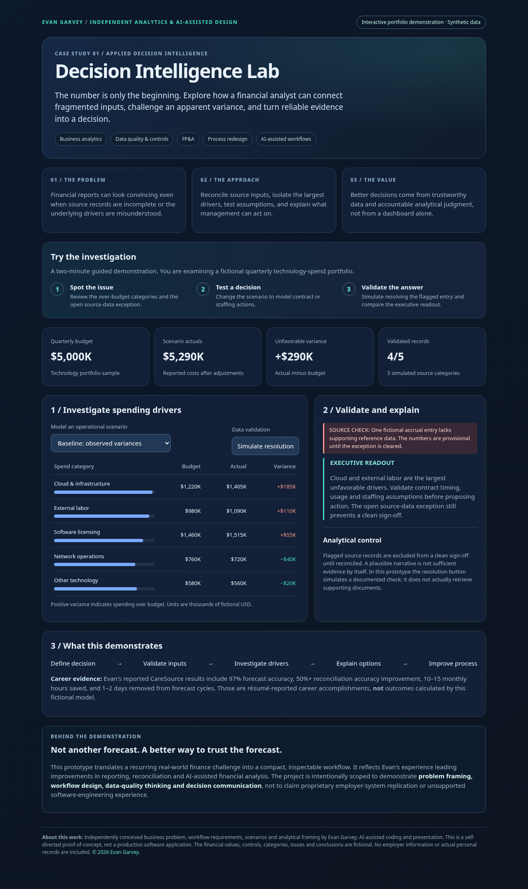

# Decision Intelligence Lab

An interactive finance analytics demonstration by Evan Garvey. Investigate a fictional quarterly technology-spend portfolio, compare operational scenarios, and examine how a source-data exception affects sign-off.

## Explore

- Review spending by category and investigate unfavorable variance.
- Model cloud contract optimization, labor timing correction, and combined actions.
- Simulate resolving and reopening a source-data exception.
- Compare the executive readout across scenarios.

## Transparency

All financial data is synthetic. The source-resolution control simulates a check; it does not retrieve documents or validate real transactions. This is a self-directed proof of concept, not production software or a statistical forecasting model.

Business problem, workflow requirements, scenarios, and analytical framing by Evan Garvey. Coding and presentation were AI-assisted. Career accomplishments cited in the demonstration are separate from its fictional model outputs.

## Run locally

Open `index.html` in a modern browser. No installation, backend, credentials, or data uploads are required.

## GitHub Pages

In repository Settings → Pages, choose **Deploy from a branch**, **main**, and **/ (root)**, then Save. Use the live URL reported by GitHub after deployment succeeds.

## Screenshot

